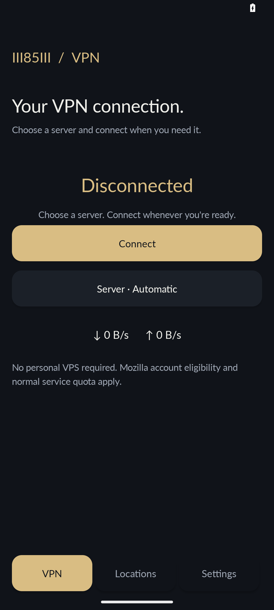
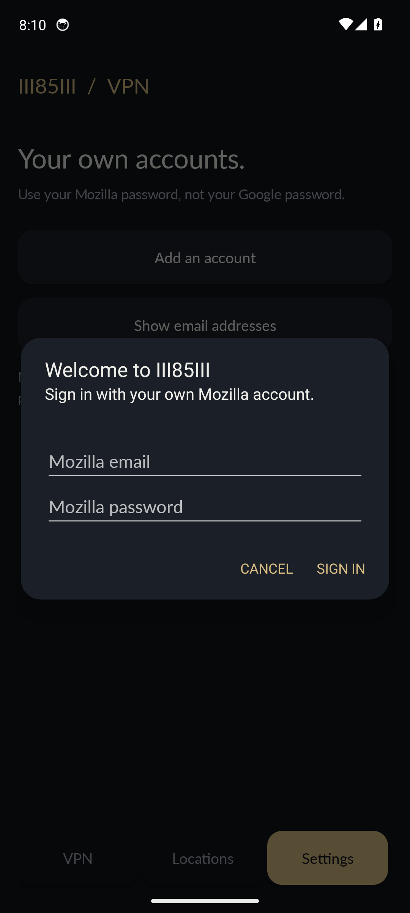

<!-- language-selector:start -->
**🇬🇧 English** · [🇮🇷 فارسی](../docs/readme/README.fa.md) · [🇸🇦 العربية](../docs/readme/README.ar.md) · [🇹🇷 Türkçe](../docs/readme/README.tr.md) · [🇩🇪 Deutsch](../docs/readme/README.de.md) · [🇫🇷 Français](../docs/readme/README.fr.md) · [🇪🇸 Español](../docs/readme/README.es.md) · [🇧🇷 Português](../docs/readme/README.pt.md) · [🇷🇺 Русский](../docs/readme/README.ru.md) · [🇨🇳 简体中文](../docs/readme/README.zh.md) · [🇯🇵 日本語](../docs/readme/README.ja.md) · [🇮🇳 हिन्दी](../docs/readme/README.hi.md)
<!-- language-selector:end -->

<p align="center"></p>

# Free VPN

### Your Mozilla connection, at home on Windows and Android.

Free VPN is a free application by **III85III** for Windows and Android. Sign in with your own eligible Mozilla account, choose a location and manage your connection from one place. No personal VPS or subscription to this application is required. Mozilla determines whether your account can use the service and what quota applies.

| Platform | Download | Requirements |
| --- | --- | --- |
| Windows | [Windows installer](https://github.com/III85III/Free-Vpn/releases/latest/download/III85III-VPN-Setup.exe) | Windows x64 |
| Android | [Android APK](https://github.com/III85III/Free-Vpn/releases/latest/download/III85III-VPN.apk) | Android 8.0+, arm64 or x86-64 |

Android is distributed directly here. Real-phone Mozilla sign-in and tunnel routing still need validation; see [completed checks and limitations](../mobile/VALIDATION.md). There is no signed App Store version yet.

[Getting started](#getting-started) · [Features](#features) · [Connection modes](#connection-modes) · [Privacy](#privacy-and-account-data) · [FAQ](#faq) · [Build](#build-and-validation)

## Getting started

1. Download **III85III-VPN-Setup.exe** from the [current release](https://github.com/III85III/Free-Vpn/releases/latest).
2. Run Setup, then open **III85III VPN**. The interface starts in English.
3. Add your own Mozilla account using your Mozilla password. If Mozilla requests a verification code, enter it in the separate code window.
4. Choose your connection mode and location, then connect. Use **Check connection** to inspect the connection result.

Windows x64 is the supported platform. The installer keeps your saved account data separate from the application, so replacing application files does not intentionally remove your accounts. The download contains no preconfigured user account.

### On Android

1. Download **III85III-VPN.apk** using the Android link above. Allow installation from the browser or file manager when Android asks.
2. Open **Settings → Mozilla accounts** and add your own account. Verification codes appear in a separate step when requested.
3. Choose a location, read the connection disclosure and approve Android's VPN permission. **App rules** lets selected applications connect directly.
4. Disconnect in Home, the persistent VPN notification or Android VPN settings. Manual disconnect does not trigger automatic reconnection.

Install future APK updates over the existing app to retain its local data. The release uses the same III85III signing identity as Android 2.2.0. Keep accounts and diagnostic files private. A running VPN indicator alone does not prove that every application or protocol is protected.

Android includes latency sorting, location search, account management, private account storage, a separate verification step, connection cancellation, privacy details and bundled dependency notices. Its interface uses the same dark and gold visual style. The mobile features differ from Windows; [mobile details](../mobile/README.md) explain the platform limits.

<p align="center">
  
  
</p>

Screenshots show a fresh test installation with no account or active connection.

### Updates from the app

Starting with Windows 2.2.3 and Android 2.3.3, a detected newer release is required before continuing to use VPN. Choose Update or Exit. This requirement is remembered across reopening; failed downloads can be retried. Existing older binaries need one normal upgrade to adopt this behavior. Checks run shortly after opening and about every five minutes while the app is open. Operating-system installation confirmation is preserved.

Windows and Android check public version information on GitHub and show a prompt when a newer version is available. Download starts when you choose it; no personal VPS is needed. Windows opens the verified installer after closing the VPN. Android checks the APK's package, version and signing identity and asks for installation confirmation.

Use **Settings → Check for updates** on Windows or **Settings → App updates** on Android. The first upgrade from Windows 2.2.0 or Android 2.3.0 must be installed once using the downloads above: those older builds do not contain the updater. Later releases can be obtained from inside the app. Keep enough free space for downloading and installation.

## Features

| Feature | What it does |
| --- | --- |
| Location search | Find a server by its country name or code. |
| Latency sorting | Measure locations when you choose and sort successful measurements from low to high. Unknown or failed measurements stay below measured results. |
| Quick connect | Use the selected location without starting a new full location scan. |
| App rules | Choose applications that should connect directly while whole-computer mode is active. |
| Multiple accounts | Add and manage your own accounts and inspect the quota reported by the service. |
| Email privacy | Hide account email addresses in the interface when sharing your screen. |
| Tray controls | Keep the app available from the Windows notification area. |
| Connection help | Inspect the exit result and local diagnostics without a slow log request blocking the status display. |
| Keyboard navigation | Use Enter/Space on custom controls and jump between pages with Ctrl+1 through Ctrl+6. |
| Search shortcuts | Press Ctrl+F to search locations or the current app list; Escape clears the filter. F1 opens Help. |
| Installer recovery | Prepare an update before replacing the previous installation, with rollback if directory promotion fails. |
| In-app updates | Check for a newer platform version, download it and start installation from the app. |
| Account selection | Choose a saved account explicitly; the Windows home button no longer requires an account to be active before connecting. |
| Service repair | Repair the Windows VPN service from Settings with administrator approval. |

Latency measurements describe response time at the moment of testing; they are not a guarantee of download speed.

## Connection modes

| Mode | Intended use |
| --- | --- |
| Whole computer | Route supported traffic through the VPN, with your app exclusions applied. |
| Windows system proxy | Configure the Windows proxy settings used by compatible browsers and applications. Applications may ignore these settings. |
| Local proxy only | Expose local HTTP/SOCKS proxy endpoints for applications configured to use them, without changing system routing. |

**App rules are exclusions:** checked applications bypass the VPN. This version does not provide enforced routing where only selected applications use the VPN. A BAT launcher or proxy environment alone cannot guarantee that every Telegram bot connection is proxied. That feature remains under development.

## Privacy and account data

- Each user signs in with their own account. Account sessions stay in that Windows user's local profile; they are not bundled into the installer or repository.
- This application does not require an III85III account or a personal VPS. Mozilla authentication and network service access still contact the relevant service providers.
- Use your **Mozilla password**, not your Google password. Signing in to Firefox in a browser does not automatically sign this application in.
- Local diagnostic logs may contain connection information. Review them before sharing; hiding emails in the interface does not sanitize a raw log export.
- Dependencies and fonts retain their licenses, included with the application.

## FAQ

**Is it free?** The application is free. Service eligibility, regional availability, quotas and renewal dates come from Mozilla. Installing this app does not create an unlimited entitlement or bypass those limits.

**Does it work on Android, iOS, macOS or Linux?** Windows and Android have direct downloads above. Android supports arm64 and x86-64. The [iOS project](../mobile/README.md) still needs Apple signing before normal installation. These are not App Store/Google Play approvals. macOS and Linux applications remain future plans.

**Does it guarantee every application or protocol will work?** No. Service restrictions apply. Arbitrary UDP, a verified kill switch and enforced Telegram-bot-only routing are not promised by this release.

**Will it fix every Mozilla sign-in error?** No. The automated tests validate local request handling and interface behavior; they do not establish that every account, challenge or remote service response succeeds. A universal HTTP 406 fix is not claimed.

**How are engine updates handled?** Builds without a configured signing key refuse signed-update operations. Update this release through its installer; an unsigned file is not accepted as a verified update to the privileged TUN service.

## Build and validation

The source includes the C# Windows interface, Go engine, build scripts and local regression fixtures. Build tools are developer dependencies; users install the application through Setup.

```powershell
.\tools\test.ps1
go -C core test ./internal/signing ./internal/tunservice
```

The regression suites cover connection-state interpretation, responsive layout, sign-in cancellation, separate verification prompts, latency actions, log polling, keyboard access and installer rollback. Generated BAT fixtures separately test local HTTP/HTTPS proxy behavior, including a direct control path. These checks do not replace live account and end-to-end tunnel validation.

[Validation details](../docs/VALIDATION.md) · [User guide](../docs/OVERVIEW.md) · [Privacy details](../docs/PRIVACY.md) · [License notices](../licenses/NOTICE.txt)
